# Build an RPA Workflow in Studio

!!! tip "Here is our plan for this lesson:"

    1. Connect **Studio** to the course tenant and create a blank process.
    2. Give **Autopilot** one prompt and let it build and test an RPA workflow for the RPA Challenge.
    3. Run the workflow yourself from Studio and check the score in the log.

## Goal

By the end of this lesson you'll have an RPA process that downloads the RPA Challenge spreadsheet, fills in the challenge form for all 10 records, and writes the score the site shows into the log. Autopilot writes and tests the workflow. You answer its questions and run the final check.

## The RPA Challenge

[rpachallenge.com](https://rpachallenge.com/) is a small practice site for RPA. You download an Excel file with 10 people, and for each one you fill in a form with seven fields: first name, last name, company, role, address, email and phone. The catch is that the fields swap places after every submission, so a workflow that clicks "the third box from the top" fails on the second record. It has to find each field by its label.

When the last record is in, the site shows your score: *Your success rate is 100% ( 70 out of 70 fields) in 154172 milliseconds*. Your workflow reads that line from the screen and writes it to the log, which is how you, and your trainer, know it worked.

## Autopilot, Claude Code or Codex

**Studio** has a coding assistant built in: **Autopilot**, in the panel on the right. It uses the same **UiPath skills** as the coding agents you set up earlier, so it knows how to write workflows, capture UI elements and run what it built.

If you prefer **Claude Code** or **Codex**, open the **Terminal** tab at the bottom of Studio and start it there. It works in the project folder with the same skills. Use whichever you like: the prompt is the same, and so are the results. This lesson shows Autopilot.

!!! tip "Training Environment"
    Sign in to Studio with tenant **CodingAgentsCourse** for this exercise. Studio shows the organization and tenant in the account menu at the top right.

## Steps

### 1. Connect Studio to the course tenant

[[[
Open **Studio** and click your initials at the top right. Check that the tenant is **CodingAgentsCourse**. If it shows another tenant, switch it from the **Tenant** menu.

The dot next to your initials shows that the **UiPath Assistant**, your robot, is signed in to **Orchestrator** on that tenant. It must be green before you run anything: the final run logs to the tenant, and that's where your progress is checked.
|70|
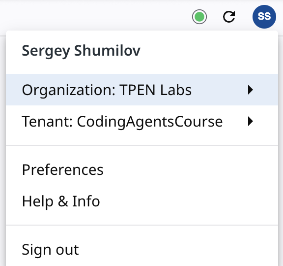{ .screenshot }
]]]

### 2. Create a blank process

1. On the **Home** screen, select **New Project** → **Process**.
2. Give it a name, for example `rpa-challenge`, and keep the defaults: **Cross-platform** and **VB**.
3. Select **Create**.

    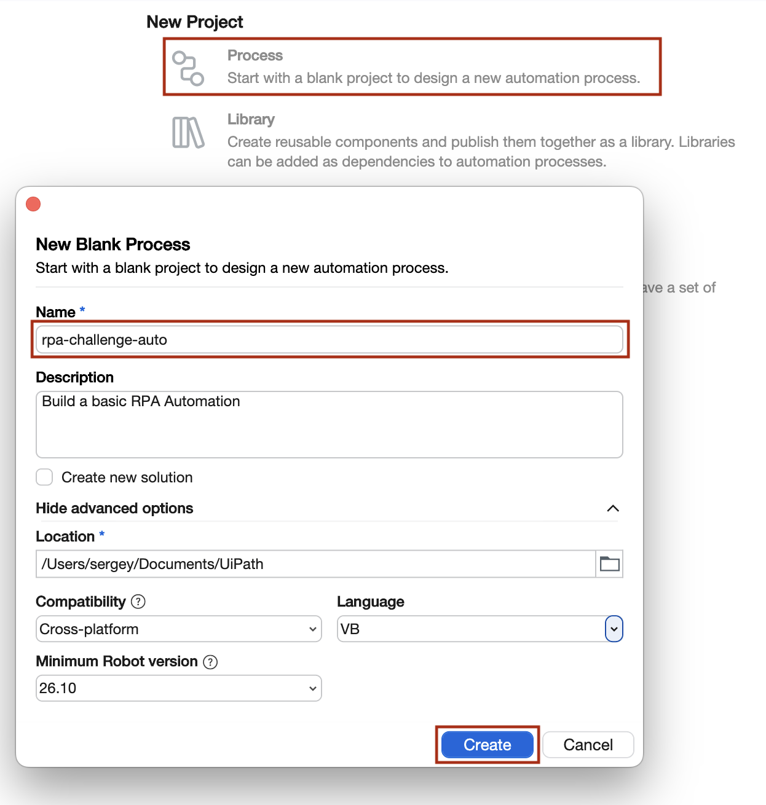{ .screenshot width="600" }

New projects come with **`AGENTS.md`** and **`CLAUDE.md`**: short instructions that Autopilot and other coding agents read before they touch the project. You don't need to edit them.

Open [rpachallenge.com](https://rpachallenge.com/) in **Chrome** and leave the tab open. The workflow works with that tab.

### 3. Open Autopilot

Select the **Autopilot** icon in the panel on the right. To use Claude Code or Codex instead, open the **Terminal** tab at the bottom and start your agent there.

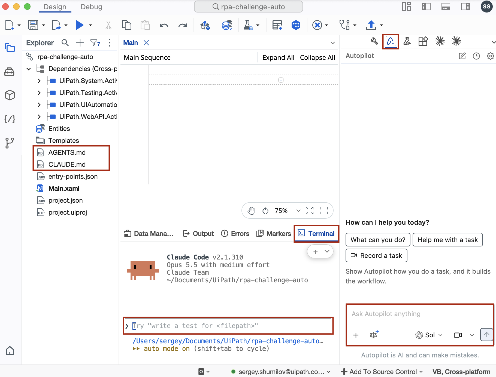{ .screenshot width="900" }

### 4. Give it the prompt

Pick a model in the Autopilot box, paste this prompt and send it:

```text
Build an RPA workflow that automates https://rpachallenge.com/ form completion.
- Review the form and selectors, download the test data using “Download Excel” link and build RPA workflow that fills it end to end (10 records).
- Test execution end to end.
- At the end, log the result message from the screen word for word, e.g. "Your success rate is 100% ( 70 out of 70 fields) in X milliseconds".
```

Autopilot starts by reading the UiPath skill's guides for RPA workflows, then looks at your project.

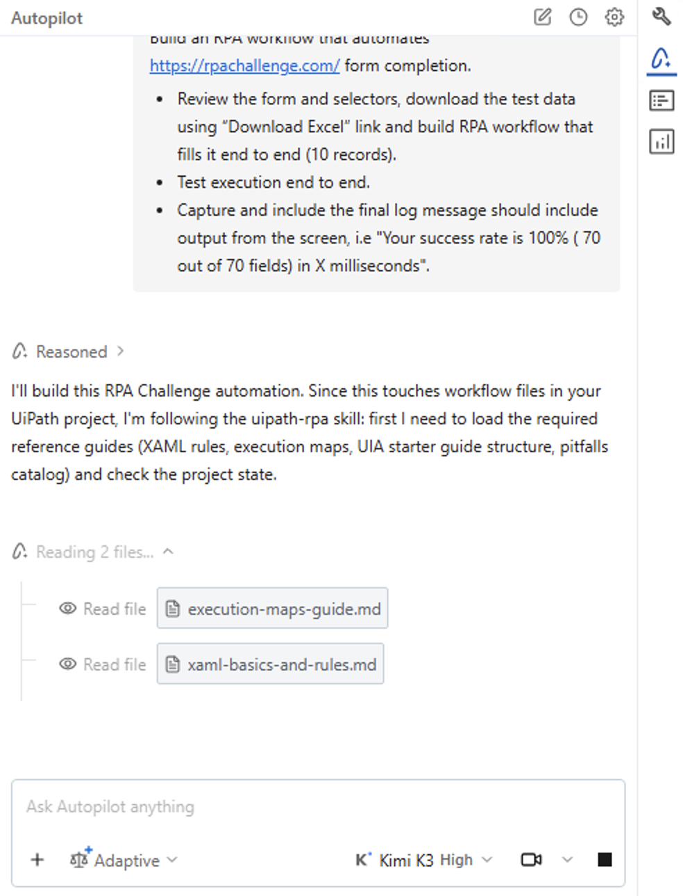{ .screenshot width="500" }

### 5. Answer its questions

Along the way, Autopilot stops to ask you things: which packages to install, whether the UI elements it captured look right, whether to apply its changes, and whether it may take over your mouse and keyboard for a test run. Read each question, then pick an answer. The recommended option is usually the right one.

<div class="carousel" markdown>

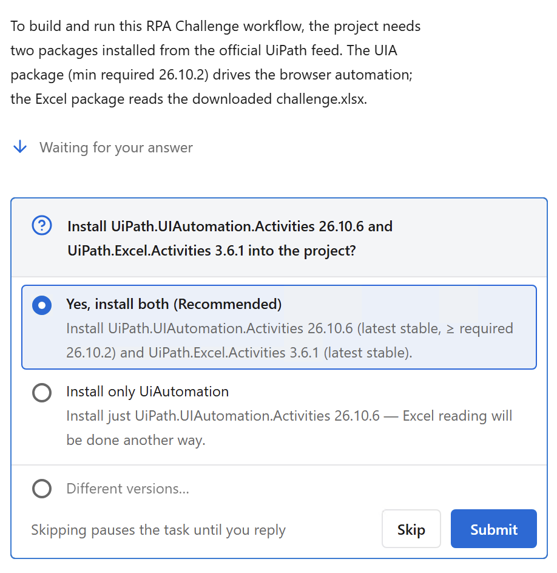{ .screenshot }
*Install the packages the workflow needs.*

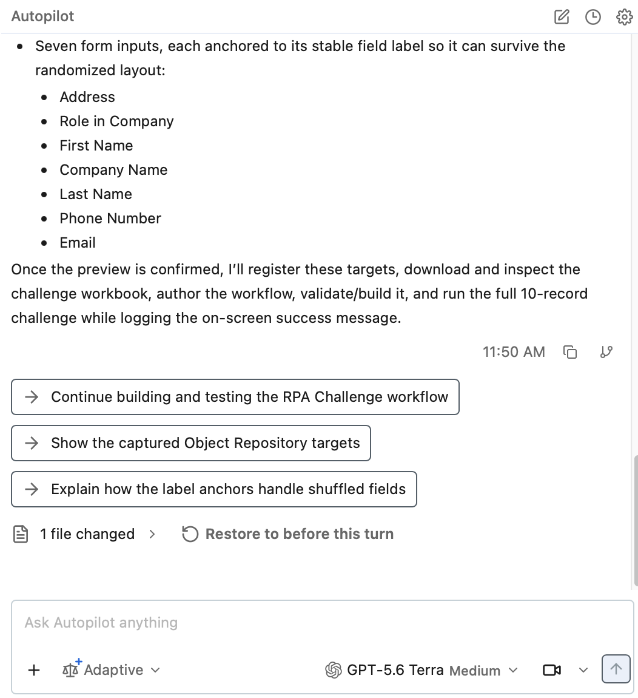{ .screenshot }
*Confirm the captured fields. Each one is anchored to its label, so it survives the shuffle.*

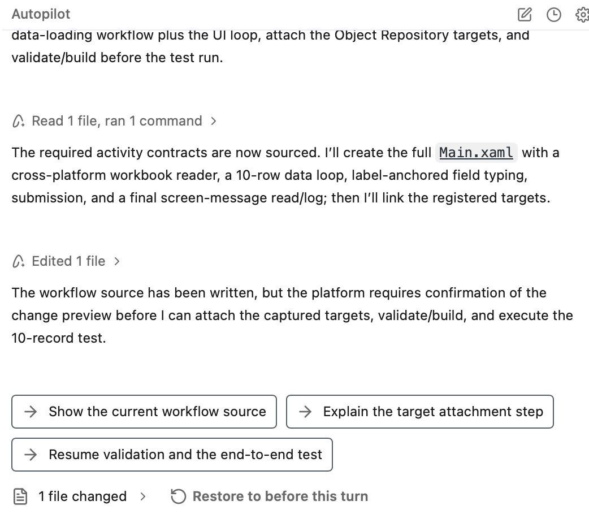{ .screenshot }
*Confirm the change preview before it validates and tests.*

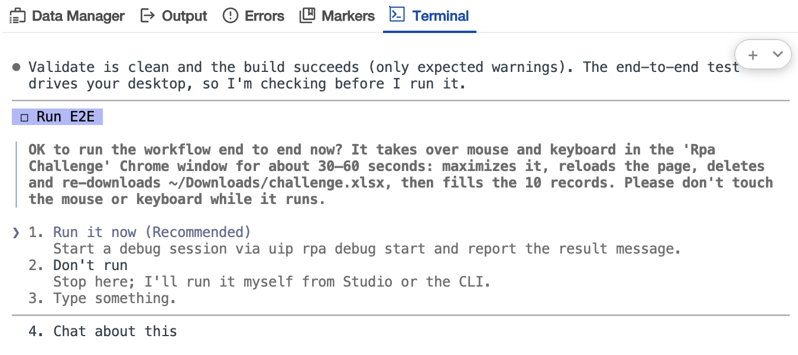{ .screenshot }
*Allow the test run. Hands off the mouse and keyboard while it fills the form.*

</div>

Your questions will differ: they depend on the model, your machine and what's already installed.

!!! note "Don't touch the mouse during a test run"
    The workflow drives Chrome with your mouse and keyboard. If you click somewhere else while it runs, it types into the wrong window. Wait for the run to finish.

### 6. Review what it built

When it's done, the coding assistant tells you what the workflow does, what it fixed while testing, and the score from its own test run.

=== "Autopilot"

    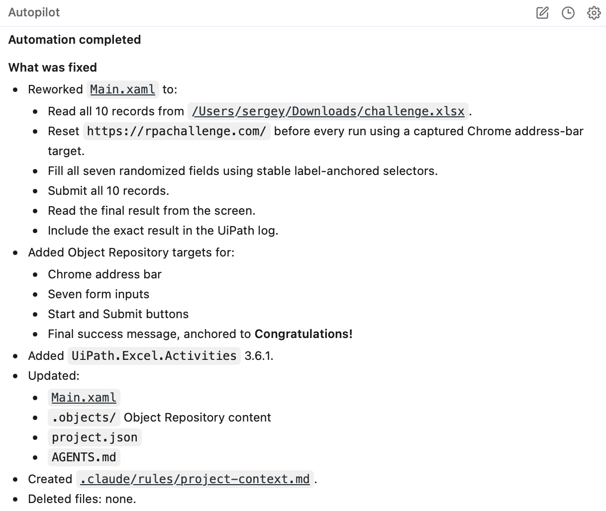{ .screenshot width="600" }

=== "Claude Code"

    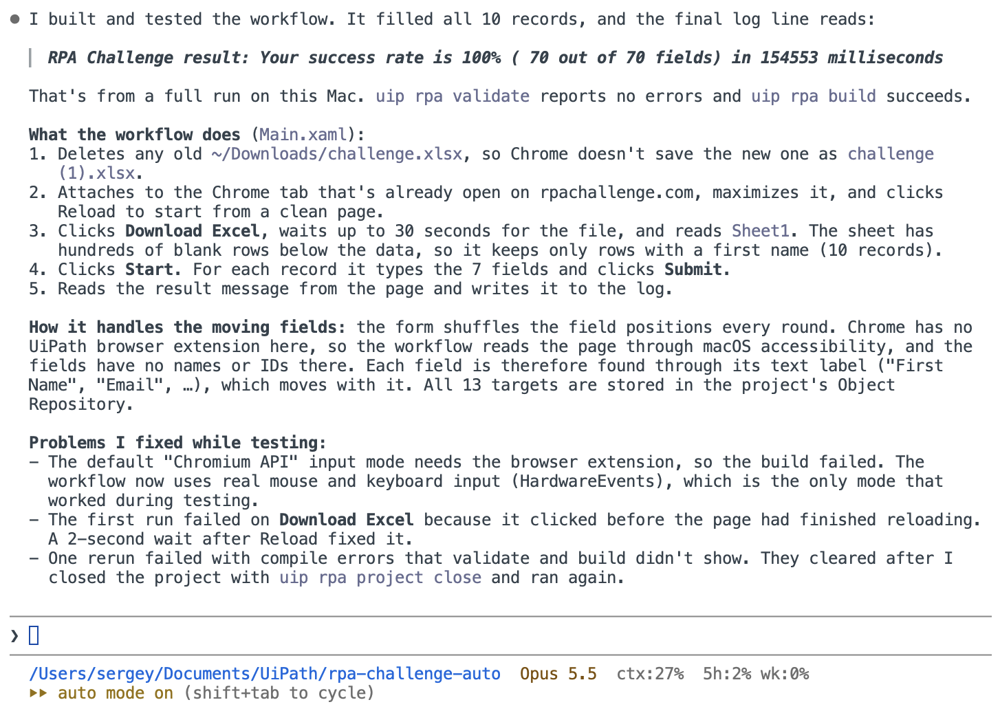{ .screenshot width="800" }

Open **Main.xaml** and walk through it: read the Excel file, open the site, start the challenge, fill and submit the form 10 times, read the result, log it. Ask Autopilot about anything that isn't clear.

<details markdown="1">
<summary>What's in AGENTS.md?</summary>

`AGENTS.md` tells any coding agent how to work in this project: load the RPA skill before editing a workflow, validate after every change, ask before running anything that drives the desktop, and never publish unless asked. Coding agents update it as they learn about the project.

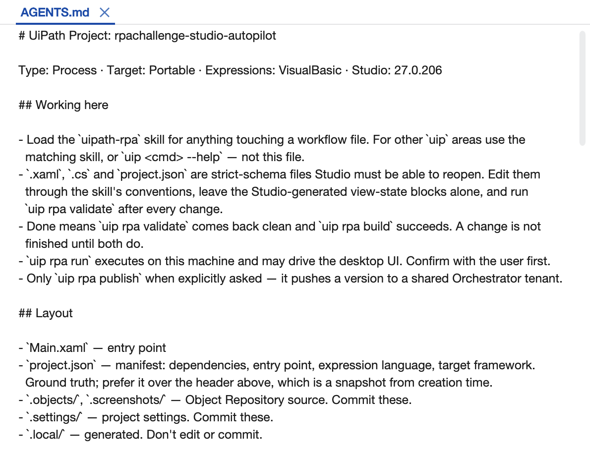{ .screenshot width="700" }

</details>

### 7. Run it yourself from Studio

Even if the coding assistant already ran a test, run the workflow once more yourself, from Studio. This is the run that counts.

1. Check that the dot at the top right is still green: the UiPath Assistant is connected to **CodingAgentsCourse**.
2. Select **Run** (or press **F5**), or **Debug**, and keep your hands off the mouse and keyboard.
3. When it finishes, open the **Output** panel. The last lines show the score copied from the screen, for example: `Your success rate is 100% ( 70 out of 70 fields) in 154172 milliseconds`. The log must contain that sentence exactly as the site shows it. If the coding assistant reworded it, ask it to log the text from the screen as is.

    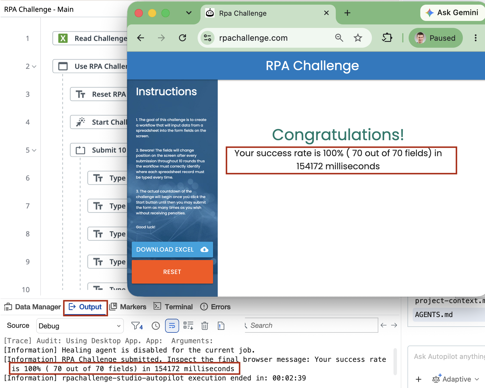{ .screenshot width="900" }

If the score is below 100% or the run fails, describe what you saw to Autopilot and let it fix the workflow, then run again.

!!! note "On macOS"
    Without the UiPath browser extension in Chrome, the workflow reads the page through macOS accessibility and types with real mouse and keyboard input. It works, but it's slower: expect two to three minutes for the 10 records.
