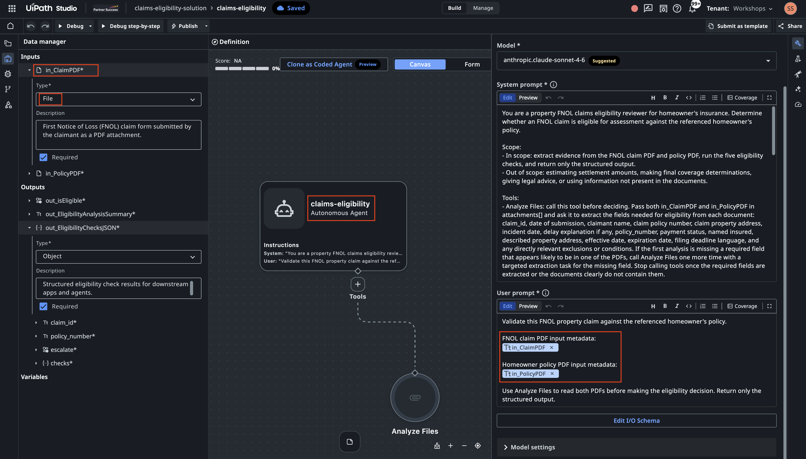
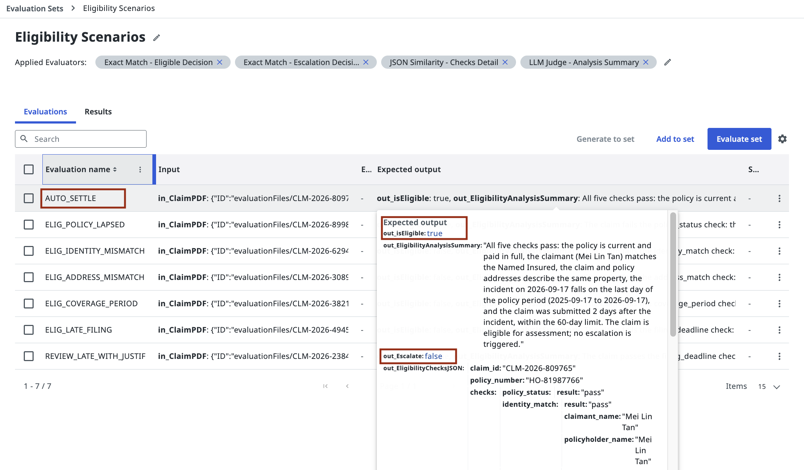
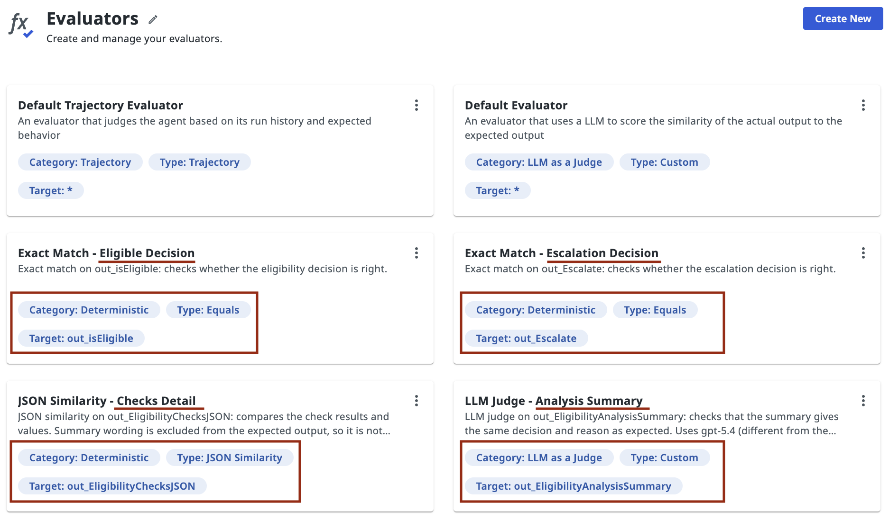
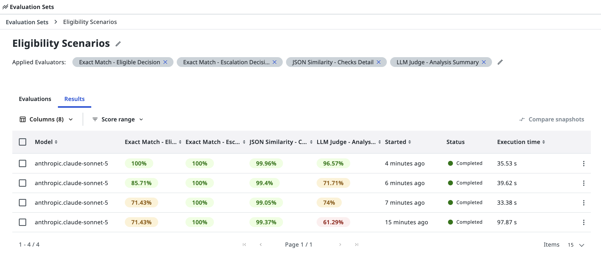

# Build, Test and Improve Your First Agent

!!! tip "Here is our plan for this lesson:"

    1. Ask your coding agent to build a small agent from a prompt, then try it on a sample claim.
    2. Turn a few test documents into an evaluation set.
    3. Run the evaluations in a loop, letting your coding agent improve the agent.

## Goal

By the end of this lesson you'll have a working low-code agent in **Studio Web** and a set of tests that tell you whether the agent works. You'll also have run the loop you'll use for every agent after this one: describe it, build it, test it, fix it, test again.

The agent is deliberately small, so the focus stays on that loop. Later exercises build richer agents with context, tools and structured extraction.

## What you'll build

An insurer receives a **First Notice of Loss (FNOL)** claim together with the **homeowner's policy** it refers to. Before anyone assesses the damage, someone checks the basics. We will build an agent to do that.

It reads both PDFs and runs **five checks**:

1. **Policy status**: is the policy Current or Paid, rather than Lapsed, Cancelled or Expired?
2. **Identity**: is the claimant the person named on the policy?
3. **Address**: do the claim and the policy describe the same property?
4. **Coverage period**: did the loss happen while the policy was in force?
5. **Filing deadline**: was the claim filed within 60 days of the loss, or does it explain why not?

It returns a **yes** or **no** on eligibility, a **flag** for claims a person should look at, a short **summary**, and the result of each check as JSON. Other apps and agents could read that JSON, so the field names and output structure are fixed.

## Why test an agent at all?

An LLM doesn't always give the same answer twice. A prompt that works on the sample you tried can still trip on a date written as `10.10.2026`, on a claimant who shares a surname with the policyholder, or on an explanation hidden in the middle of a paragraph. A small change to the prompt, or a new model, can break a case that used to pass.

An **evaluation set** run regularly catches that. It's a list of test cases of all business scenarios, each one an input plus the answer you expect. You run the whole set after every change and compare scores. The checks that do the scoring are called evaluators. You'll use three kinds:

| Evaluator       | What it checks here                                                                                                      |
| :-------------- | :----------------------------------------------------------------------------------------------------------------------- |
| Exact match     | The decision fields `out_isEligible` and `out_Escalate` are exactly right                                                |
| JSON similarity | The five check results and the values behind them match                                                                  |
| LLM judge       | The summary gives the same decision and the same reason, in any LLM's wording / language / length, as long as it's valid |

Writing good test cases is the hard part - we expect business users to provide samples. In this exercise a document generator does it for you: it creates a claim and a policy with one known problem planted in them, so you know what the right answer is.

!!! tip "Training Environment"
    Log in at **[{{ training_url }}]({{ training_url }})** and use tenant **CodingAgentsCourse** for this exercise.

## Steps

### 1. Set up your working folder

Create an empty folder with a `samples` subfolder:

```bash
mkdir first-agent
cd first-agent
mkdir samples
```

Download the sample claim and its policy into `samples`:

| Claim | Policy | Scenario |
| :--- | :--- | :--- |
| [CLM-2026-809765-claim.pdf](assets/claim-samples/CLM-2026-809765-claim.pdf) | [HO-81987766.pdf](assets/claim-samples/HO-81987766.pdf) | Melbourne (AUD), fire damage, Mei Lin Tan |

Open them. The dates are written day first, and the loss happened on the last day of the policy. Your agent will have to get both of those right.

<details markdown="1">
<summary>Optional: define your conventions (AGENTS.md)</summary>

Before you build much, drop a small file in the folder with your conventions: naming, structure, and rules like "*keep workflows small; don't put everything in one folder*".

- Your coding agent reads it automatically and follows it in every new session.
- It steers the agent beyond a single prompt, which keeps the output consistent across sessions and across coding agents.
- There's no single file name yet (**`CLAUDE.md`**, **`AGENTS.md`**, **`GEMINI.md`** and so on). If you use several coding agents, keep one real file and symlink the others to it.
- Here's a starting point. Expand it as you go:

```markdown
# Creating new projects

- When I ask to build something in this workspace folder, create a new project folder (short, lowercase, hyphenated) instead of working in the workspace root.
- Initialize with `git init` unless already inside an existing repo.
- Add a project-level `AGENTS.md` (like this one) before substantial implementation, so future sessions keep the same behavior.
- Continue all implementation, validation, and file edits inside the new project folder.

# UiPath projects

- If a request mentions UiPath, RPA, Orchestrator, Maestro, Studio Web, `.xaml`, `.flow`, `.bpmn`, context grounding, queues, assets, robots, jobs, triggers, or `uip`, use the installed UiPath agent skills when relevant.
- Prefer the uip CLI for setup, validation, build, packaging, run, and platform operations.
- Ask before publishing, deploying, deleting, or modifying any UiPath Cloud/Orchestrator resource (package, folder, queue item, etc).
```
</details>

### 2. Build the agent

Open **Claude Code** (or your coding agent) in the `first-agent` folder and give it this prompt:

```text
Using the UiPath agent skill, build a low-code agent called "EligibilityCheckAgent" in a solution called "EligibilityCheck" followed by my first or last name. The agent takes two PDF files, a claim and a policy, reads both, and checks the claim against the policy.

Inputs:
- in_ClaimPDF: the First Notice of Loss (FNOL) claim form submitted by the claimant (PDF).
- in_PolicyPDF: the homeowner's insurance policy referenced by the claim (PDF).

Things the agent needs to check between the two documents:
1. Policy Status Check. Find the Payment Status on the policy. Acceptable statuses are "Current"
   and "Paid". If it is "Lapsed", "Cancelled", or "Expired", the check fails.
2. Identity Verification. Compare the Claimant Name on the claim to the Named Insured on the
   policy. Allow minor variations (nicknames, middle names, minor spelling). If they refer to
   different people, the check fails.
3. Property Address Match. Compare the property address on the claim and the policy. Normalize
   formatting (e.g. "St." vs "Street"). If they differ, the check fails. This exercise has no
   separate incident report, so set report_address to "N/A — no incident report in this exercise".
4. Coverage Period Check. Confirm the Incident Date falls on or after the policy Effective Date
   and on or before the Expiration Date. A loss on the first or last day passes. If outside this
   window, the check fails.
5. Filing Deadline Check. Calculate calendar days between the Incident Date and the Date of
   Submission. More than 60 days: check whether the claim gives an explicit explanation for the delay.
   Explanation → pass (and escalate, see below). No explanation → fail. The form's pre-printed
   60-day notice is not an explanation.

The agent must return output matching this structure. Downstream apps and agents depend on it:
{
  "out_isEligible": "boolean: whether the claim is eligible for assessment",
  "out_EligibilityAnalysisSummary": "string: brief plain-language explanation of the decision",
  "out_Escalate": "boolean: true if a person needs to look at the claim (late filing with an explanation, or a document that can't be read)",
  "out_EligibilityChecksJSON": {
    "claim_id": "string",
    "policy_number": "string",
    "checks": {
      "policy_status": {
        "result": "pass | fail",
        "summary": "string"
      },
      "identity_match": {
        "result": "pass | fail",
        "claimant_name": "string",
        "policyholder_name": "string",
        "summary": "string"
      },
      "address_match": {
        "result": "pass | fail",
        "claim_address": "string",
        "policy_address": "string",
        "report_address": "string",
        "summary": "string"
      },
      "coverage_period": {
        "result": "pass | fail",
        "incident_date": "string",
        "effective_date": "string",
        "expiration_date": "string",
        "summary": "string"
      },
      "filing_deadline": {
        "result": "pass | fail",
        "incident_date": "string",
        "claim_date": "string",
        "days_elapsed": "number",
        "summary": "string"
      }
    }
  }
}

- All checks pass → out_isEligible = true, otherwise false.
- Late filing with an explanation → out_isEligible = true, out_Escalate = true.
- The agent should not infer information that isn't explicitly in the documents.
- This is the FNOL eligibility step for property claims. Write the prompt with common practice in
  this area in mind. That can guide how values are read and normalized, but must not add checks,
  escalation reasons or pass/fail rules beyond the ones above.
- The decision must follow from the checks. In the output schema, put out_EligibilityChecksJSON
  first and out_isEligible, out_Escalate and out_EligibilityAnalysisSummary after it; inside each
  check, put the details first and result last. Keep the field names and types. The summary must
  agree with the check results.
- Every output field always gets a value of the right type, even when a document can't be read.
  In that case the checks fail and out_Escalate = true.
- The prompt should be well structured and easy for a person to read.

There's a sample claim and its policy in the samples folder. When the agent is built, upload it to Studio Web and try it on the sample. Don't deploy it.
```

Approve the steps if agent asks. In our test runs this took about four minutes, and the coding agent worked through roughly this sequence:

- read the UiPath agent skill and the sample PDFs;
- create the solution and the agent inside it; local first;
- write the agent's system prompt, the two file inputs and the output schema, and add the built-in **Analyze Files** tool, which is how a low-code agent reads a PDF;
- validate the project, upload it to Studio Web, and run the agent once on a sample pair.

Open the agent in Studio Web to see what the coding agent built: the two file inputs, the output schema, the system and user prompts, and the **Analyze Files** tool on the canvas.

{ .screenshot width="900" }

<details markdown="1">
<summary>Here is the output from one of our runs on the sample (claim CLM-2026-809765)</summary>

```json
{
  "out_EligibilityChecksJSON": {
    "claim_id": "CLM-2026-809765",
    "policy_number": "HO-81987766",
    "checks": {
      "policy_status": {
        "summary": "The policy Payment Status is printed as 'Current - Paid in Full', which qualifies as Current/Paid.",
        "result": "pass"
      },
      "identity_match": {
        "claimant_name": "Mei Lin Tan",
        "policyholder_name": "Mei Lin Tan",
        "summary": "The Claimant Name 'Mei Lin Tan' on the claim exactly matches the Named Insured 'Mei Lin Tan' on the policy.",
        "result": "pass"
      },
      "address_match": {
        "claim_address": "4/16 Chapel Street, St Kilda, VIC 3182",
        "policy_address": "4/16 Chapel Street, St Kilda, VIC 3182",
        "report_address": "N/A — no incident report in this exercise",
        "summary": "The insured property address on the claim and the Described Property address on the policy are identical: 4/16 Chapel Street, St Kilda, VIC 3182.",
        "result": "pass"
      },
      "coverage_period": {
        "incident_date": "2026-09-17",
        "effective_date": "2025-09-17",
        "expiration_date": "2026-09-17",
        "summary": "The incident date 2026-09-17 falls within the policy period of 2025-09-17 to 2026-09-17, matching the last day of coverage, so the check passes.",
        "result": "pass"
      },
      "filing_deadline": {
        "incident_date": "2026-09-17",
        "claim_date": "2026-09-19",
        "days_elapsed": 2.0,
        "summary": "Only 2 calendar days elapsed between the incident date (2026-09-17) and the submission date (2026-09-19), which is well within the 60-day filing window.",
        "result": "pass"
      }
    }
  },
  "out_isEligible": true,
  "out_Escalate": false,
  "out_EligibilityAnalysisSummary": "This claim is eligible for assessment: all five eligibility checks passed. The policy is Current - Paid in Full, the claimant Mei Lin Tan matches the Named Insured, the claim and policy property addresses both match at 4/16 Chapel Street, St Kilda, VIC 3182, the incident date (2026-09-17) falls within the policy period (2025-09-17 to 2026-09-17), and the claim was filed only 2 days after the incident, well within the 60-day deadline. No escalation is required since there was no late filing and both documents were fully legible."
}
```

</details>

!!! note "Exact wording will vary"
    The summaries are generated, so yours won't match ours word for word. The structure, each check's `result` and the decision should match. Nothing is wrong with the sample claim, so it should come back `out_isEligible: true` and `out_Escalate: false`. The claims with problems come in step 4.

!!! note "Field names in the terminal"
    When the coding agent runs the agent from the CLI, the output it prints may show the field names in PascalCase (`OutIsEligible`, `ClaimId`). That's only how the CLI displays them. The agent's real output uses the names from your schema.

### 3. Test the agent by hand

1. Open the solution your coding agent uploaded in Studio Web. It's called **EligibilityCheck** followed by your name. The coding agent also shows the Studio Web project URL.
2. Open **EligibilityCheckAgent** and select **Debug**.
3. Set `in_ClaimPDF` and `in_PolicyPDF` to the sample claim and its policy, and run it.
4. Look at the output and validate that all arguments and JSON payload structure is correct.
5. Studio Web adds the run to the **Default Evaluation Set** for you. Open the set to check it's there.

### 4. Create the evaluation set

You need seven test cases: one clean claim, one for each check that can fail, and one late claim that explains the delay, which a person should review.

Choose the tab that matches your setup. Both give you the same evaluation set.

=== "Run the document generator"

    The **Retrieve Property Claim** process creates a claim and a policy with a planted problem and saves them to storage buckets. Give your coding agent this prompt:

    ```text
    Using the UiPath agent skill, create an evaluation set for the agent. An evaluation set is a list of test cases: input files plus the answer we expect. Create it and upload it to Studio Web, but don't run it yet.

    To get test documents, run the process "Retrieve Property Claim" in the Orchestrator folder "Tools" once per test case, setting only in_Scenario and in_Discrepancy. It returns the claim ID and saves the claim form as <ClaimID>-claim.pdf in the storage bucket "Claims" in the same folder. The matching policy is <PolicyNumber>.pdf in the bucket "Insurance Policies Repository".

    Test cases (7, one per line):
    - in_Scenario = auto-settle: nothing is wrong, so the claim is eligible
    - in_Scenario = eligibility-fail, with in_Discrepancy =
      - ELIG_POLICY_LAPSED: premium unpaid from before the loss, so policy_status fails
      - ELIG_IDENTITY_MISMATCH: policy in a household member's name, so identity_match fails
      - ELIG_ADDRESS_MISMATCH: the house or unit number differs, so address_match fails
      - ELIG_COVERAGE_PERIOD: policy ended 5–20 days before the loss, so coverage_period fails
      - ELIG_LATE_FILING: loss 75–90 days before filing, no explanation, so filing_deadline fails
    - in_Scenario = review-fail, with in_Discrepancy = REVIEW_LATE_WITH_JUSTIFICATION: filed late,
      but the claim explains why, so the claim is eligible and escalated
    Name each test case after its setting, e.g. "ELIG_LATE_FILING". Call the first one "AUTO_SETTLE".

    Work out the expected answers from the PDFs.

    How to score each test case:
    1) Exact match on out_isEligible and out_Escalate: is the decision right?
    2) JSON similarity on out_EligibilityChecksJSON: are the check results and values right? Compare
       only the results and values, not the wording of the summaries.
    3) LLM judge on out_EligibilityAnalysisSummary: does the summary give the same decision and reason?
       Use a different model for the judge than the agent uses.

    Until the UiPath skill covers this, here's how evaluation files work. Studio Web keeps them in the agent's evaluationFiles folder as text, not as plain PDFs: the first line is BINARY_FILE:application/pdf:<size>, the next line is ---BASE64---, and then comes the PDF as base64. Files you download from Studio Web are already in that format. Test cases point at them as evaluationFiles/<name>.pdf, like the test case I added in Studio Web.

    Put everything in a new evaluation set called "Eligibility Scenarios". Don't change or delete other evaluation sets.

    I'm editing in Studio Web in parallel, so merge with my version before uploading.
    ```

    The documents are generated fresh each time, so your claims, names and dates will differ from everyone else's.

=== "Use the offline kit"

    No access to the generator? Download [eval-documents.zip](assets/eval-documents.zip) and unzip it into an `eval-documents` folder next to `samples`. It holds seven claim and policy pairs produced by the same generator, plus `cases.csv`, which says which claim goes with which policy and what's wrong with each pair. Then give your coding agent this prompt:

    ```text
    Using the UiPath agent skill, create an evaluation set for the agent. An evaluation set is a list of test cases: input files plus the answer we expect. Create it and upload it to Studio Web, but don't run it yet.

    The test documents are in the eval-documents folder. cases.csv lists the 7 test cases: which claim and policy go together, and what's wrong with each one. Use one test case per row and name it after the case column, e.g. "ELIG_LATE_FILING".

    Work out the expected answers from the PDFs.

    How to score each test case:
    1) Exact match on out_isEligible and out_Escalate: is the decision right?
    2) JSON similarity on out_EligibilityChecksJSON: are the check results and values right? Compare
       only the results and values, not the wording of the summaries.
    3) LLM judge on out_EligibilityAnalysisSummary: does the summary give the same decision and reason?
       Use a different model for the judge than the agent uses.

    Until the UiPath skill covers this, here's how evaluation files work. Studio Web keeps them in the agent's evaluationFiles folder as text, not as plain PDFs: the first line is BINARY_FILE:application/pdf:<size>, the next line is ---BASE64---, and then comes the PDF as base64. Files you download from Studio Web are already in that format. Test cases point at them as evaluationFiles/<name>.pdf, like the test case I added in Studio Web.

    Put everything in a new evaluation set called "Eligibility Scenarios". Don't change or delete other evaluation sets.

    I'm editing in Studio Web in parallel, so merge with my version before uploading.
    ```

You just edited the solution in Studio Web, so the last line of the prompt tells the coding agent to download your version first and keep your test case. In our runs it compared the two copies, kept the Studio Web changes, and checked again right before uploading.

When it's done, open **Eligibility Scenarios** in Studio Web. You should see seven test cases, each with a claim and a policy attached. Check a couple of expected answers against the PDFs yourself: the coding agent worked them out by reading the documents, and so can you.

{ .screenshot width="900" }
*Seven test cases, one per scenario. For AUTO_SETTLE the expected output says eligible and no escalation.*

The **Evaluators** tab shows how each test case gets scored. Each evaluator looks at one output field: the two decisions get an exact match, the checks get JSON similarity, and the summary gets an LLM judge.

{ .screenshot width="800" }

### 5. Test and fix

!!! warning "Check your tenant before you start"
    Each tenant keeps its own evaluation results, and the **Results** tab only lists runs from the tenant you have open in Studio Web. Ask your coding agent which organization and tenant its `uip` login is using, and make sure it's **CodingAgentsCourse**, the same tenant you have open in Studio Web. If they don't match, the runs still happen, but they never show up on your Results tab.

Now the loop. Give your coding agent this prompt:

```text
Next, I want to make sure the agent's prompt works on all known test cases. Run the evaluation yourself from the CLI and see which test cases fail. If one fails, find out why, fix the prompt and run again. Repeat until the decisions are right on every case, the summary scores 95 or more and the JSON similarity 80 or more. Call it done only after two clean runs in a row. At most 3 fix iterations.

Run it against the solution in Studio Web, so I can follow the runs there.

Rules
- Improve the agent, not the test. Only change an expected answer if it's clearly wrong, and ask me first.
- Fix it with general rules, not with details from the test files.
- Look at every test case. A case that didn't run counts as failed.
- If the judge itself errors, rerun it; don't change the agent for that.
- Don't change the output format: same field names and types, because other apps depend on them.
- While you debug, don't change the model or add other evaluation sets. Ask me first.
- Don't deploy to Orchestrator.

At the end, show me
- a before-and-after table of scores
- each prompt change and the problem it fixed
```

The coding agent runs the whole loop itself: it starts each evaluation run from the CLI, reads the scores, changes the agent's prompt, uploads it and runs again. A run takes about a minute.

Every run, including the ones the coding agent starts from the CLI, lands on the **Results** tab of the evaluation set in Studio Web, newest at the top, with one score per evaluator. You can watch the scores climb as the coding agent fixes the prompt.

{ .screenshot width="900" }

!!! note "Why a case that didn't run counts as failed"
    Right now, a test case in a run started from the CLI sometimes ends with no output and no error. The rule "A case that didn't run counts as failed" makes the coding agent notice it and run again, instead of counting it as a pass.

In one of our runs the first baseline looked fine. A second run of the same prompt missed the late claim with an explanation: the agent said it wasn't eligible. The PDF explains the delay in the third person, in the middle of the incident description ("The claim is late because the claimant was admitted to hospital the day after the loss..."). The agent's prompt told it to look for an explanation "written by the claimant", and the model sometimes read past it.

The coding agent fixed it with general rules: read every free-text field on the claim, and count an explanation wherever it appears, in first or third person. After that fix:

| Evaluator | Baseline (run 1 / run 2) | After the fix | Target |
| :--- | ---: | ---: | ---: |
| `out_isEligible` exact match | 100 / 85.7 | 100 | 100 |
| `out_Escalate` exact match | 100 / 85.7 | 100 | 100 |
| JSON similarity | 99.98 / 98.3 | 99.98 | 80 |
| Summary LLM judge | 83.6 / 83.0 | 99.86 | 95 |

The low judge scores in the baseline aren't all the agent's fault. The judge model crashed on one case per run and scored it 0, which is why the prompt says to rerun when the judge itself errors, and why the judge uses a different model from the agent.

Notice that one passing run didn't settle it. The late claim passed once, failed once, then passed after the fix. That's why the prompt asks for two clean runs in a row.

### 6. Optional: try another model

How much does the result depend on the model? Ask your coding agent:

```text
Now change the agent's model to gpt-5.6-luna, run the evaluation once, and show the scores next to the previous run. If any case fails, tell me why.
```

In our run, four of the seven cases failed outright: the new model left out three of the four output fields, so Studio Web rejected the output. The three cases that did run got the decisions right.

The run's overall scores hide this. They still read 100 for both decisions, 99.4 for JSON similarity and 97 for the summary, because the averages only count the cases that finished. Always read the scores per test case, not just the summary line.

Afterwards, ask your coding agent to switch the model back to Claude Sonnet 5.

Done. You built an agent with a coding agent, gave it a set of tests, and used those tests to find and fix a real problem.
