# Build the Invoice Matching Solution

!!! tip "Here is our plan for this lesson:"

    1. Give your coding agent one prompt that describes the whole process.
    2. Run the process from **Studio Web** with invoices that have a known problem planted in them.
    3. Review the invoices the agent flags in **Action Center**, approve one and reject one, and check what happened.

## Goal

By the end of this lesson you'll have an invoice matching process in your Studio Web workspace, built by your coding agent from a plain-language description. You'll have run it end to end: one invoice paid automatically, one approved by you, and one rejected with an e-mail to the supplier drafted by the agent.

## What you'll build

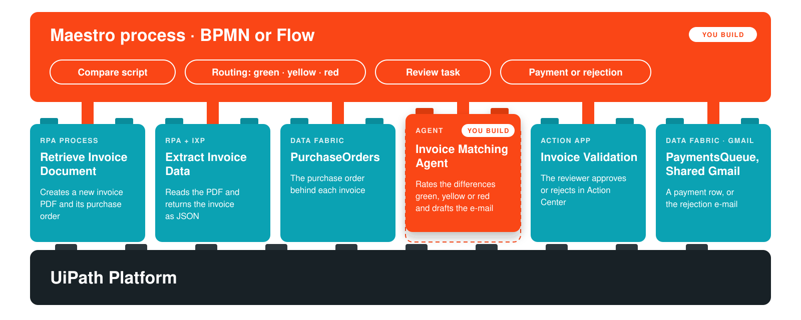{ width="900" }

The process takes one invoice at a time:

1. A provided process creates a new supplier invoice as a PDF, together with its purchase order. A second provided process reads the PDF with **IXP** (Intelligent eXtraction & Processing) and returns the invoice data.
2. The process looks up the purchase order in **Data Fabric** by the PO number on the invoice.
3. A **script** compares the two: vendor, buyer, tax, currency, every line and the totals. An identical invoice goes straight to payment.
4. If anything differs, an **agent** looks at both documents and the differences and rates the invoice:

    | Rating | Means | Example |
    | :--- | :--- | :--- |
    | **Green** | only cosmetic differences | "Ltd." instead of "Limited", an address written in another order |
    | **Yellow** | the same goods, presented differently | a reworded line, packaging on its own line, a partial delivery |
    | **Red** | a real problem | another vendor, another tax, an item you didn't order |

    The agent also writes a short summary for the reviewer and, for yellow and red, a polite draft e-mail to the supplier.

5. Green goes to payment. Yellow and red become a task in **Action Center**, where a reviewer sees the invoice next to the purchase order with the differences highlighted, and approves or rejects it.
6. Payment is a row in the **PaymentsQueue** table. A rejection sends the e-mail, as the reviewer left it, to you (not to the supplier yet).

### How the data moves

Maestro calls each block and hands its output to the next one. The blue labels are the data it passes along.

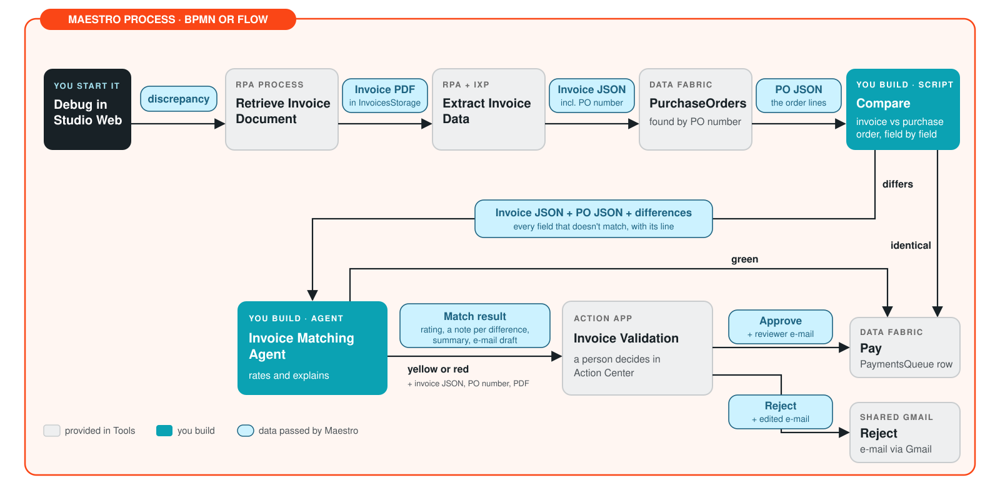{ width="900" }

## Why a script first and an agent second?

An exact comparison is cheap, fast and always gives the same answer, so it decides everything it can. An agent is good at the part a script can't judge: whether "Tape Dispenser" plus a separate "packaging" line is the same thing you ordered, or whether a line that now says "File Folders" where the order said "Wireless Charger" is a different product. In that last case every number matches, so only the agent catches it.

The agent also catches mistakes the script can't tell from real differences. In one of our runs, IXP read the city "Iasi" in a supplier's address as "lasi". The script flagged the difference, the agent rated it a reading error, and the invoice was paid without bothering anyone.

The point is a higher automation rate. Today every mismatch goes to a reviewer; with the agent in between, only the invoices that need a decision do, and the reviewer still makes that decision.

## What's already in the tenant

You build only the process and the agent. Everything else is provided in the shared **Tools** folder, and your coding agent looks up how to call it there:

| Resource | What it does |
| :--- | :--- |
| **Retrieve Invoice Document** | Creates a new invoice PDF in the **InvoicesStorage** bucket and its purchase order. You choose which problem it plants, and how often |
| **Extract Invoice Data (IXP)** | Reads the invoice PDF and returns its data as JSON |
| **Invoice Validation** action app | The reviewer's screen: the invoice PDF, the purchase order, the highlighted differences, the draft e-mail, Approve or Reject |
| **PurchaseOrders**, **PaymentsQueue** | The Data Fabric tables for the purchase orders and the payments |
| **Shared Gmail Connection**, **Shared Data Fabric Connection** | Integration Service connections for the e-mail and, if the process needs one, for Data Fabric |

!!! tip "Training Environment"
    Log in at **[{{ training_url }}]({{ training_url }})** and use tenant **CodingAgentsCourse** for this exercise, both in the browser and in the `uip` CLI your coding agent uses. Run `uip login status` to check, and switch with `uip login tenant set CodingAgentsCourse` if it shows another tenant.

## Steps

### 1. Set up your working folder

Create an empty folder and open your coding agent in it:

```bash
mkdir invoice-matching
cd invoice-matching
```

You don't need to download anything. The coding agent finds what it needs in the tenant.

### 2. Build the solution

Choose your flavour and give your coding agent this prompt. The tabs differ in two places: the flavour in the first line, and the end of the solution name.

=== "Maestro BPMN"

    ```text
    Build an invoice matching solution as a Maestro BPMN process in my Studio Web workspace.

    Process background. Suppliers send us invoices for our purchase orders. Today an existing automation compares each invoice with its purchase order, and anything that isn't an exact match goes to a person. That's about half of them. Most of those differences are harmless and acceptable, like a product name in line item written another way or packaging on its own line. So I want an agent in between that tells the harmless ones from the real problems.

    These are already in the tenant, in the Tools folder. Use them as they are:
    - "Retrieve Invoice Document" gives me a new invoice: the PDF in the InvoicesStorage bucket and the invoice number. 
    - "Extract Invoice Data (IXP)" reads the invoice PDF and returns its data as JSON.
    - The "Invoice Validation" action app, where a reviewer sees the invoice next to the purchase order with the differences highlighted, and picks Approve or Reject.
    - The Data Fabric tables PurchaseOrders and PaymentsQueue.
    - Shared Gmail Connection and Shared Data Fabric Connection.

    Look up their inputs and outputs in the tenant and build to them. The app's inputs describe the result it expects, so the process has to hand it exactly that.

    What the process should do:
    1. Get a new invoice, extract data from it, and look up its purchase order by the PO number on the invoice. When I run it, I want to choose what kind of difference the new invoice has and how often, so I can try the review too.
    2. Compare the two with a script first: vendor, buyer, tax, currency, every line item and the totals. If everything is identical, the invoice goes straight to payment. Note: The extraction doesn't write things exactly like the purchase order does: numbers can come back as 1.00 instead of 1, spacing can differ, and the vendor address may end with the country. Treat those as equal, otherwise no invoice would ever pass. Any other difference in wording still counts.
    3. If anything differs, an agent called "Invoice Matching Agent" looks at both documents and the differences, and rates the invoice. 
    - Green means only cosmetic differences, like "Ltd." and "Limited" or an address written in another order. 
    - Yellow means the same goods presented differently: a line reworded, one line split over several lines or with packaging on its own line, as long as it still adds up to what we ordered, or a partial delivery where every invoiced line matches the order. 
    - Red means a real problem: another vendor, even if only the tax ID differs by one digit, another tax, something we didn't order, a different item, more than we ordered, or a purchase order we can't find. 
    The agent also writes a short summary for the reviewer and, for yellow and red, a polite draft e-mail to the supplier: for yellow it asks them to confirm the differences, for red it asks for a corrected invoice. Keep the agent's own answer simple, and let the process bring it into the form the app expects.
    4. Green goes to payment. Yellow and red go to the reviewer for now. Once I trust the agent, I'll send yellow straight to payment too. Assign the review task to me, and put the invoice number in its title.
    5. Payment means a row in PaymentsQueue. If the reviewer rejects, send the rejection e-mail, as the reviewer left it, to me (not the supplier yet) through the shared Gmail connection.

    Call the solution "Invoice Matching <my name> BPMN" and upload it to Studio Web. Don't deploy anything as part of this build. Test the parts you can from here; I'll run the whole process with Debug in Studio Web. Then tell me how to run it and where the review task will show up.
    ```

=== "Maestro Flow"

    ```text
    Build an invoice matching solution as a Maestro Flow in my Studio Web workspace.

    Process background. Suppliers send us invoices for our purchase orders. Today an existing automation compares each invoice with its purchase order, and anything that isn't an exact match goes to a person. That's about half of them. Most of those differences are harmless and acceptable, like a product name in line item written another way or packaging on its own line. So I want an agent in between that tells the harmless ones from the real problems.

    These are already in the tenant, in the Tools folder. Use them as they are:
    - "Retrieve Invoice Document" gives me a new invoice: the PDF in the InvoicesStorage bucket and the invoice number. 
    - "Extract Invoice Data (IXP)" reads the invoice PDF and returns its data as JSON.
    - The "Invoice Validation" action app, where a reviewer sees the invoice next to the purchase order with the differences highlighted, and picks Approve or Reject.
    - The Data Fabric tables PurchaseOrders and PaymentsQueue.
    - Shared Gmail Connection and Shared Data Fabric Connection.

    Look up their inputs and outputs in the tenant and build to them. The app's inputs describe the result it expects, so the process has to hand it exactly that.

    What the process should do:
    1. Get a new invoice, extract data from it, and look up its purchase order by the PO number on the invoice. When I run it, I want to choose what kind of difference the new invoice has and how often, so I can try the review too.
    2. Compare the two with a script first: vendor, buyer, tax, currency, every line item and the totals. If everything is identical, the invoice goes straight to payment. Note: The extraction doesn't write things exactly like the purchase order does: numbers can come back as 1.00 instead of 1, spacing can differ, and the vendor address may end with the country. Treat those as equal, otherwise no invoice would ever pass. Any other difference in wording still counts.
    3. If anything differs, an agent called "Invoice Matching Agent" looks at both documents and the differences, and rates the invoice. 
    - Green means only cosmetic differences, like "Ltd." and "Limited" or an address written in another order. 
    - Yellow means the same goods presented differently: a line reworded, one line split over several lines or with packaging on its own line, as long as it still adds up to what we ordered, or a partial delivery where every invoiced line matches the order. 
    - Red means a real problem: another vendor, even if only the tax ID differs by one digit, another tax, something we didn't order, a different item, more than we ordered, or a purchase order we can't find. 
    The agent also writes a short summary for the reviewer and, for yellow and red, a polite draft e-mail to the supplier: for yellow it asks them to confirm the differences, for red it asks for a corrected invoice. Keep the agent's own answer simple, and let the process bring it into the form the app expects.
    4. Green goes to payment. Yellow and red go to the reviewer for now. Once I trust the agent, I'll send yellow straight to payment too. Assign the review task to me, and put the invoice number in its title.
    5. Payment means a row in PaymentsQueue. If the reviewer rejects, send the rejection e-mail, as the reviewer left it, to me (not the supplier yet) through the shared Gmail connection.

    Call the solution "Invoice Matching <my name> Flow" and upload it to Studio Web. Don't deploy anything as part of this build. Test the parts you can from here; I'll run the whole process with Debug in Studio Web. Then tell me how to run it and where the review task will show up.
    ```

You can leave `<my name>` as it is: the coding agent takes your name from your login.

Approve the steps when the coding agent asks. The first thing it does is load the UiPath skill for your flavour:

=== "Maestro BPMN"

    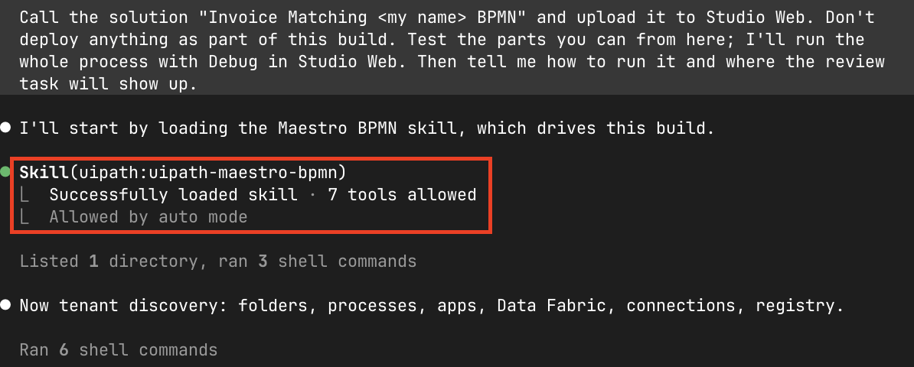{ .screenshot width="700" }

=== "Maestro Flow"

    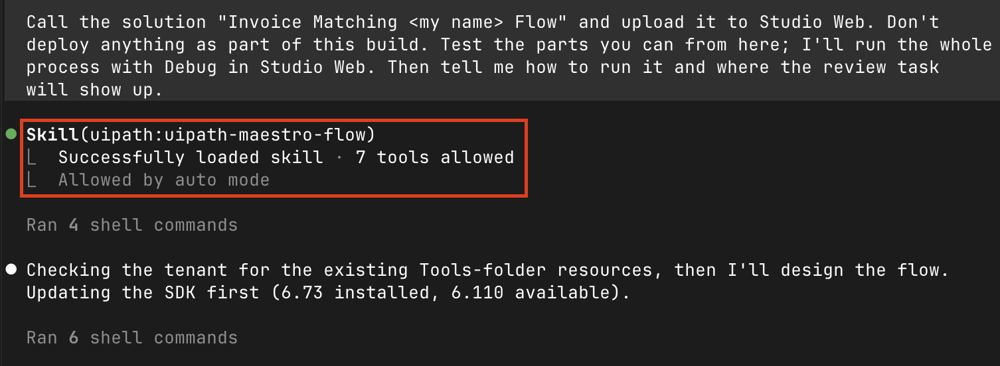{ .screenshot width="700" }

In our latest runs it worked for 15 to 30 minutes before handing over, roughly in this order:

- looked up the two processes, the app, the tables and the connections in the tenant, and read their inputs and outputs;
- wrote the compare script and tested it on its own machine against real purchase orders;
- built the agent and the process around it, validated them, and uploaded the solution to Studio Web.

It may ask a question where the prompt leaves a choice open. Answer as the business owner would.

When it's done, the coding agent tells you how to run the process and where the review task will show up. It doesn't run the whole process itself: the agent step only runs from Studio Web, so that part is yours.

### 3. Run a red invoice

1. Open the solution in Studio Web. It's called **Invoice Matching** followed by your name and the flavour, and the coding agent gives you its link. Open the process: the coding agent's work is on the canvas.

    === "Maestro BPMN"

        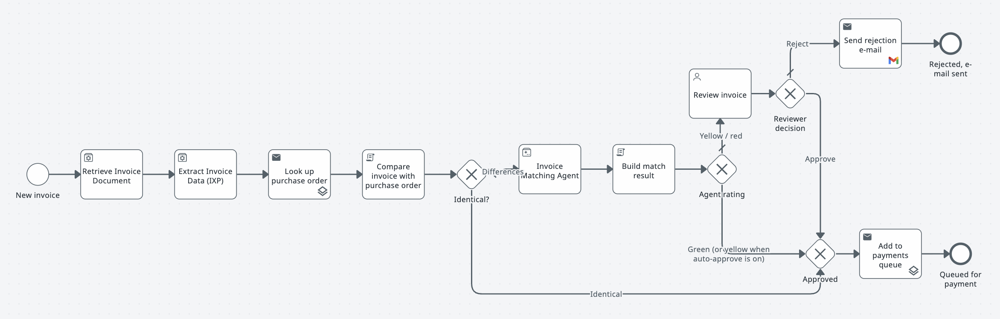{ .screenshot width="900" }

    === "Maestro Flow"

        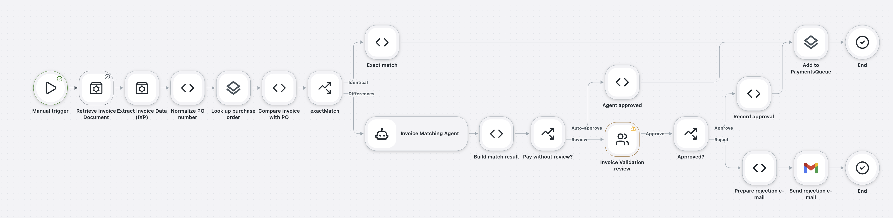{ .screenshot width="900" }

        The review step may show a warning that its **Reject** outcome has no next step. Leave it as it is: in our builds a decision right after the review step sends Approve and Reject their own ways. Connecting **Reject** as well makes both paths run.

    !!! warning "Red steps on the canvas mean the wrong tenant"
        Before you run anything, check that Studio Web is on tenant **CodingAgentsCourse**. If any step on the canvas shows in red, Studio Web is looking in another tenant and can't find the provided processes, the app or the connections. Switch to **CodingAgentsCourse** and open the solution again.

2. Select **Debug**. The process asks for its inputs. The coding agent tells you their names; one chooses the problem planted in the invoice, another how often a problem is planted. Pick `DESCRIPTION_DIFFERENT_ITEM`: one line names a different product at the price and quantity you ordered. Then start the run.

    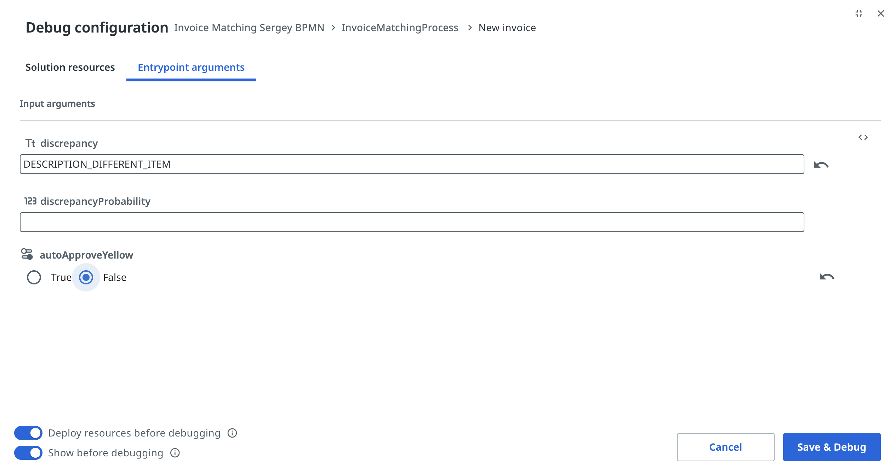{ .screenshot width="700" }

3. The run goes through the provided processes and the agent, then stops at the review step and waits for you. The debug view links to the new task.

    === "Maestro BPMN"

        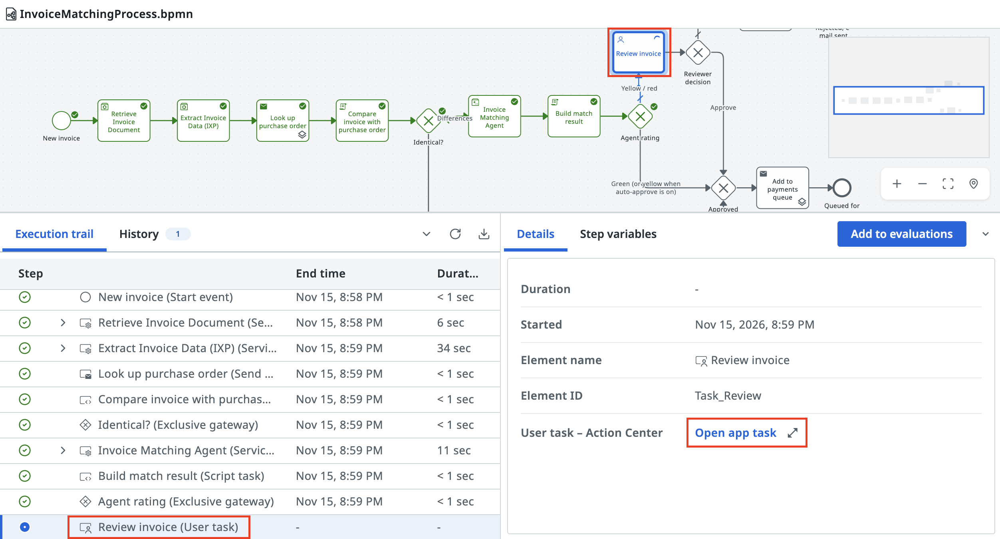{ .screenshot width="900" }

        Select **Review invoice** in the execution trail, then **Open app task** in its details.

    === "Maestro Flow"

        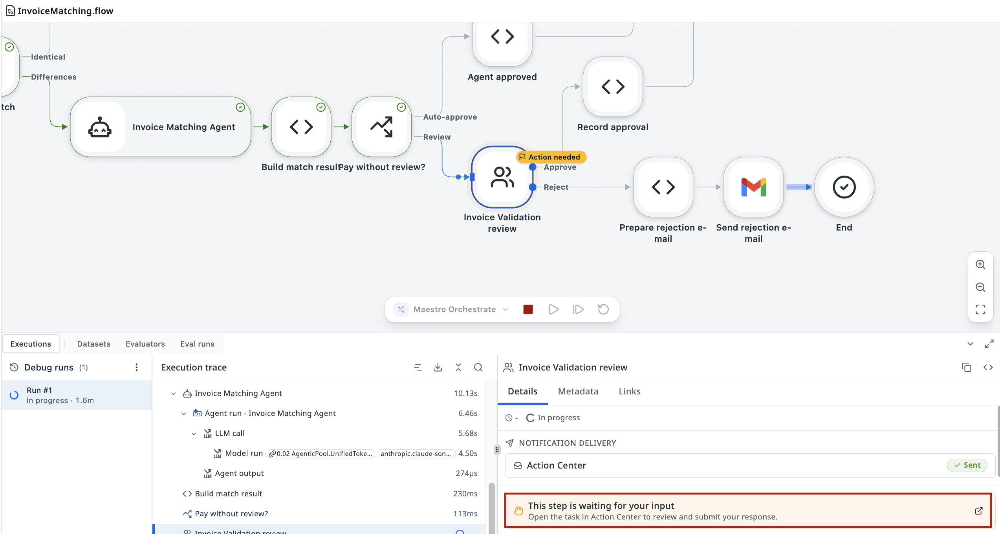{ .screenshot width="900" }

        Select the review step. Its details say the step is waiting for your input and link to the task.

### 4. Review it in Action Center and reject it

1. The task opens in **Action Center** in the **Invoice Validation** app. It's assigned to you, and its title has the invoice number and the rating.
2. Look through the app. The agent's summary and rating are at the top, and every difference is highlighted on both sides.

    <div class="carousel carousel--wide" markdown>

    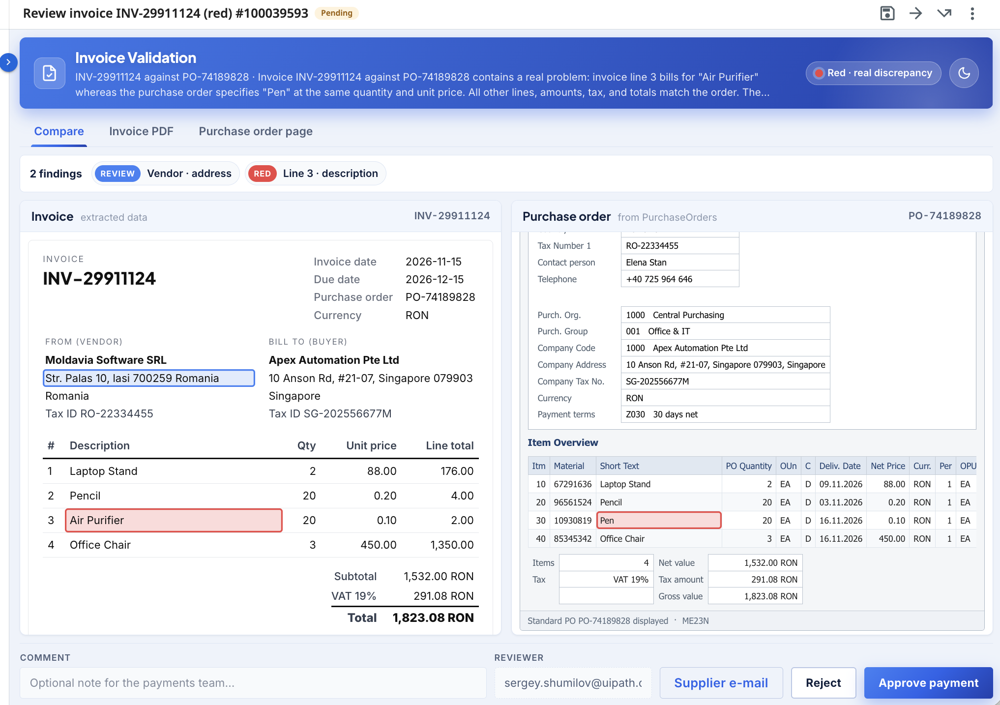{ .screenshot }
    *Compare: the invoice data next to the purchase order, with the findings as chips above.*

    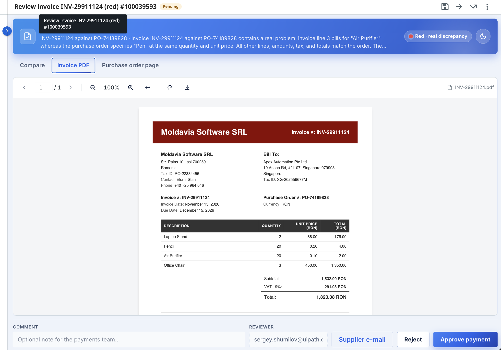{ .screenshot }
    *Invoice PDF: the document the supplier sent.*

    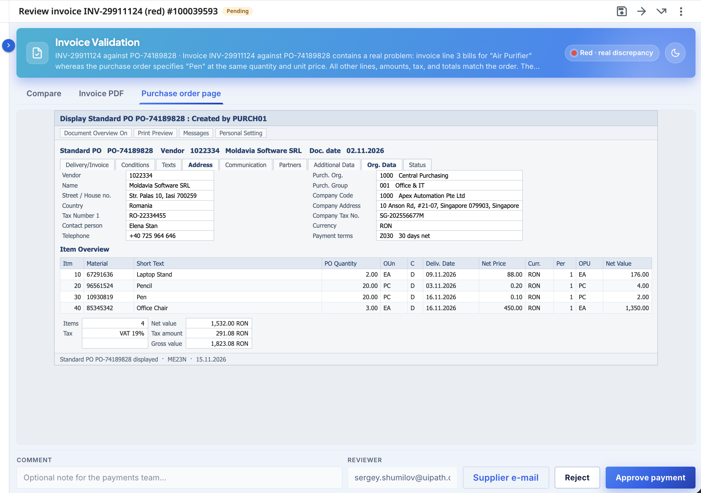{ .screenshot }
    *Purchase order page: the order as the ERP shows it.*

    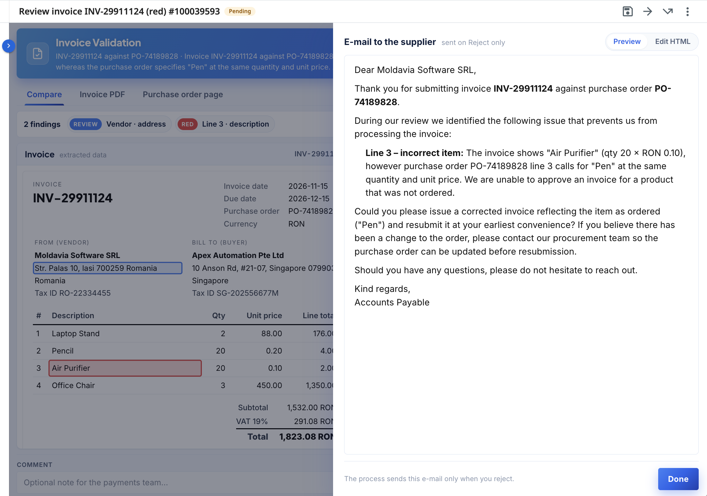{ .screenshot }
    *Supplier e-mail: the agent's draft, sent only if you reject.*

    </div>

3. Check that the agent rated it red and explains which line is wrong.
4. Open **Supplier e-mail** and edit the draft if you like, then select **Reject**.

The debug run continues on the rejection path and sends the e-mail, as you left it, to your inbox from the shared Gmail mailbox.

=== "Maestro BPMN"

    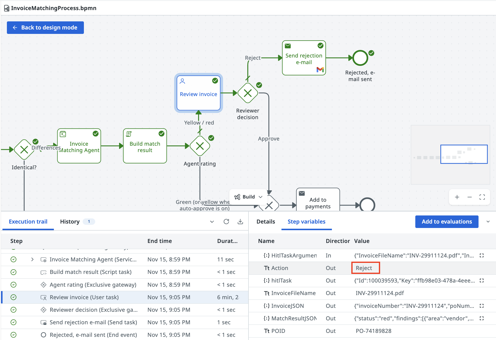{ .screenshot width="900" }

=== "Maestro Flow"

    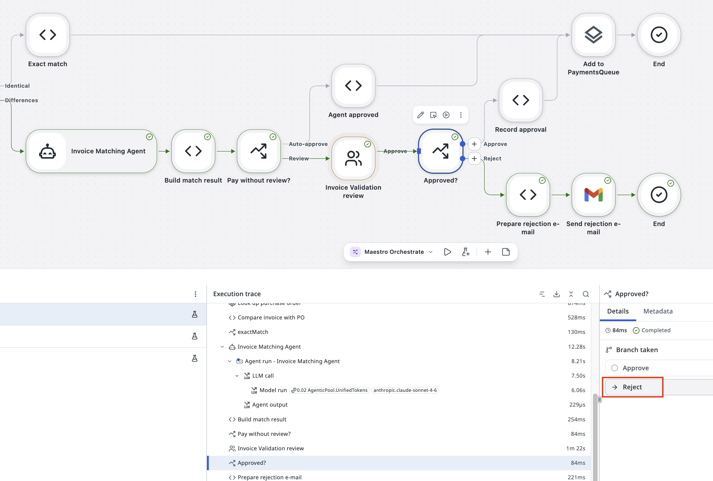{ .screenshot width="900" }

### 5. Run a yellow invoice and approve it

1. Run **Debug** again, this time with `EXTRA_LINE_PACKAGING`, or set the probability to `100` if your build has no list.
2. Open the task from the debug view. Check that the agent rated it yellow: the packaging line adds up to what you ordered.
3. Select **Approve payment**.

The debug run continues and writes a row to **PaymentsQueue**, with your e-mail as the approver.

### 6. Run a clean invoice

Run **Debug** once more with `none`. The script finds no difference, the agent never runs, and the invoice is paid without a task. Sometimes IXP misreads a character, as in the "Iasi" example above. The agent then rates the invoice green and it's paid all the same.

!!! note "Exact wording will vary"
    The invoices are generated fresh each time, and the agent's summaries and e-mails are written by a model, so yours won't match anyone else's. The rating and the highlighted differences should.

Done. Your coding agent built a process with a script, an agent and a person in it, and you ran each path once.
